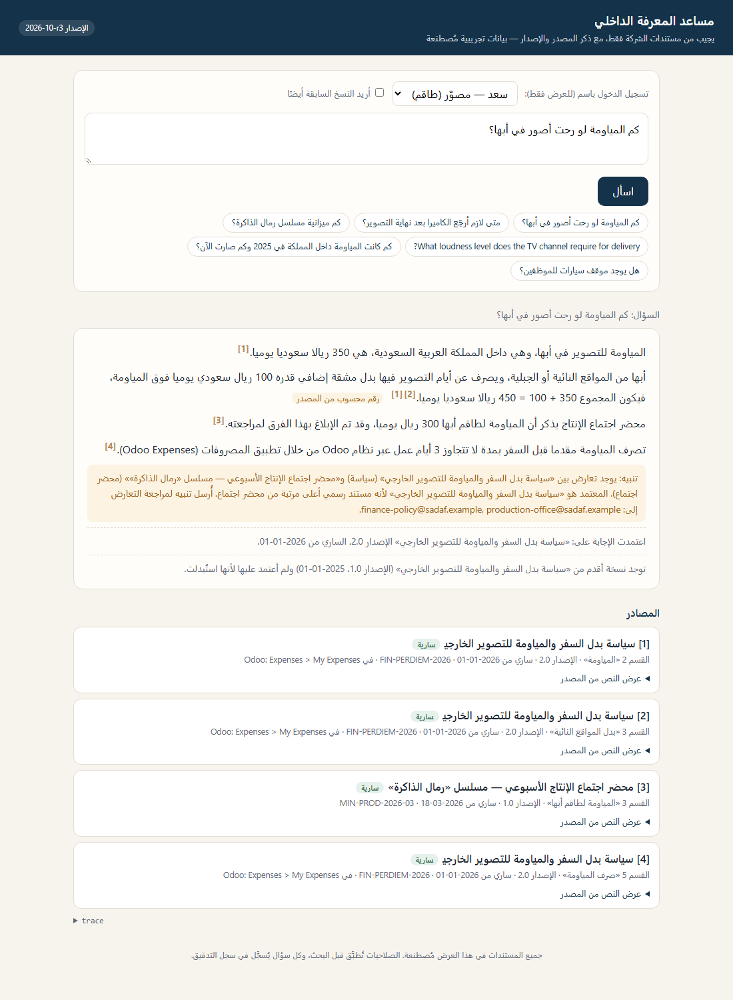
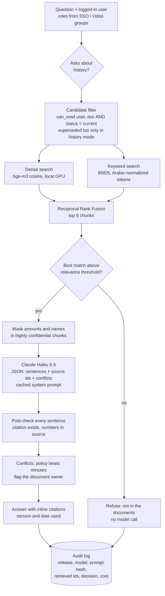
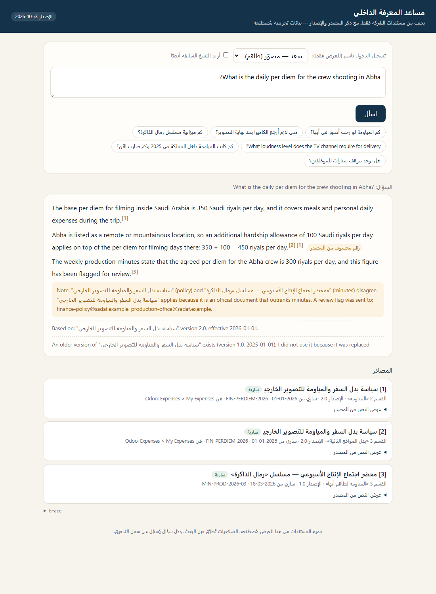
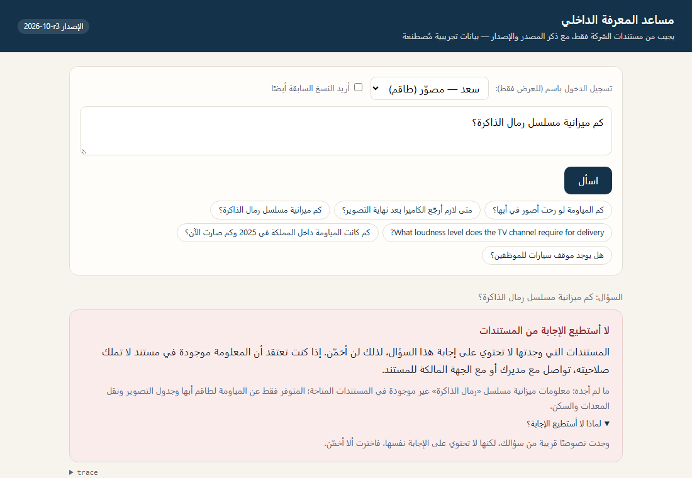
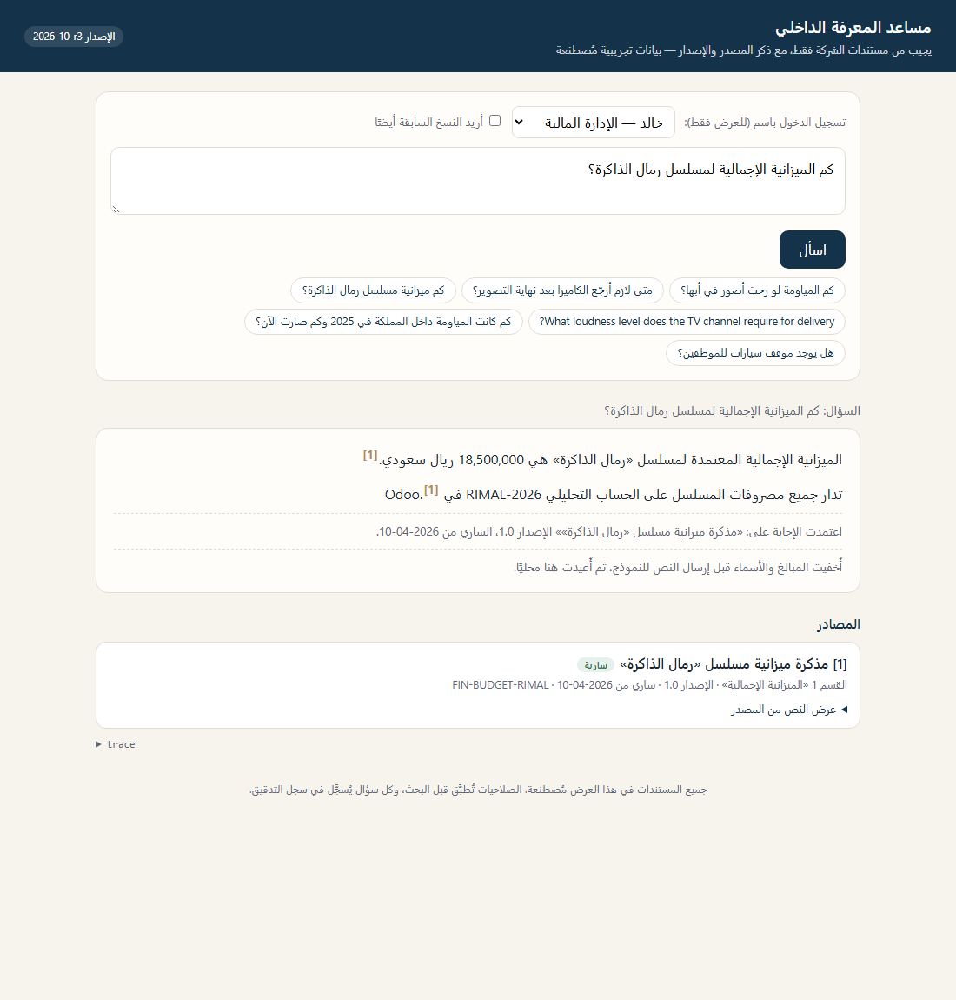
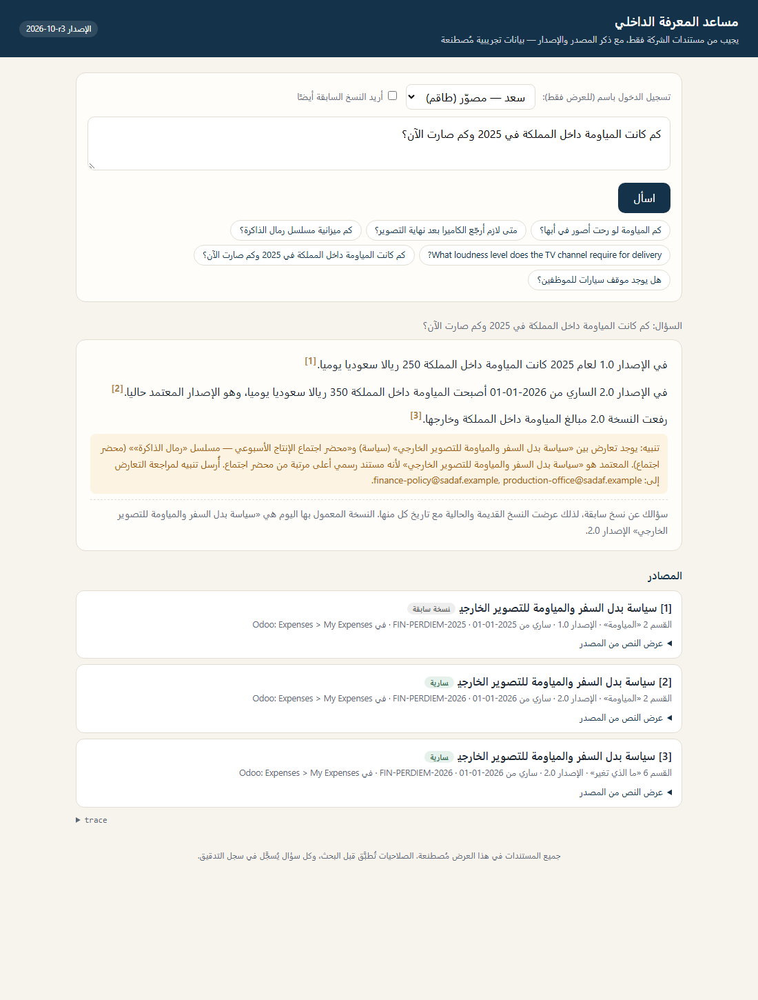
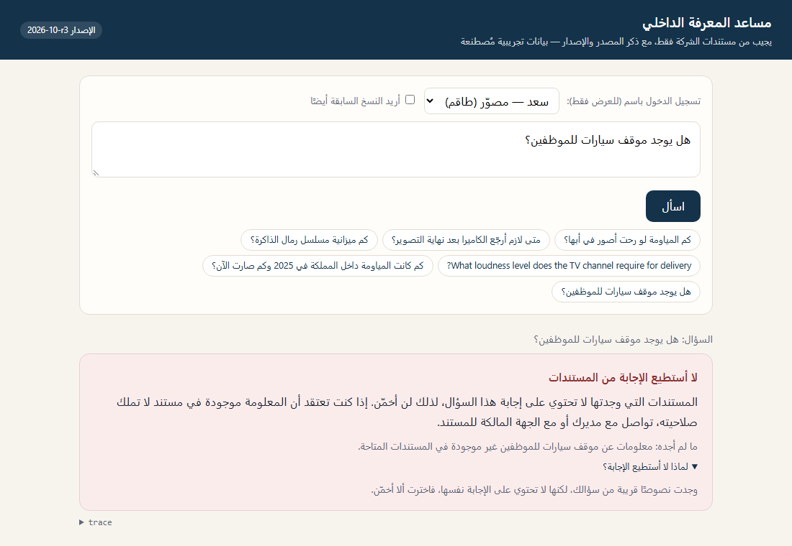
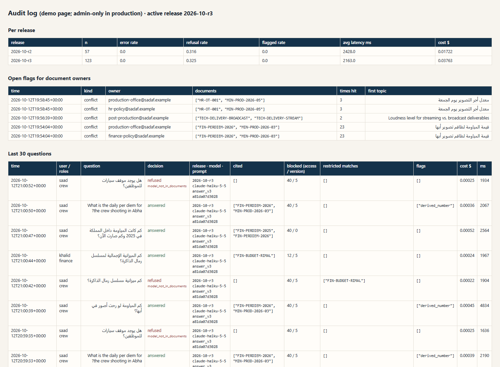

# sadaf-knowledge-assistant

An internal knowledge assistant for a TV drama production house: staff ask in Arabic (formal or Saudi dialect) or English, and it answers **only from company documents**, with a citation on every sentence.

> **All documents in `corpus/` are synthetic.** They were written for this demo to look like a production company's internal policies. None of them is a real document of any company.

Employees ask about per diem in Abha, overtime on a Friday shoot, or how to deliver episodes to a channel. The assistant answers from the right document and says which version and date it used. The design keeps the dangerous decisions out of the model. **Permissions are applied before retrieval**, so a crew member's search never even scores the budget memo, whatever the question says. The **latest-version rule** comes from document metadata (`supersedes`, `effective_date`), so an old policy can't win by sounding more relevant. A **relevance gate** refuses before any model call when nothing close enough exists. A **cheap post-check** then verifies every sentence and every number against the source it cites. Conflicts between an official policy and meeting minutes are surfaced, not silently resolved: the policy wins, both are cited, and the document owner is flagged. Highly confidential text is **masked before it reaches an external model** and restored locally. Every answer is logged with the release, model, prompt hash and retrieved chunk IDs. A 55-question eval set with a regression gate runs before every release, and a rollback switch pins the previous model and prompt.

**بالعربية باختصار:** مساعد داخلي يجيب عن أسئلة الموظفين من مستندات الشركة فقط، وبجانب كل جملة مصدرها (المستند والقسم والإصدار والتاريخ). الصلاحيات تُطبَّق قبل البحث، فلا يرى فرد الطاقم مذكرة الميزانية مهما كتب في سؤاله. يعتمد دائمًا على أحدث نسخة سارية، ويقول «لم أجد الإجابة في المستندات» بدل أن يخمّن. إذا تعارض محضر اجتماع مع سياسة رسمية، يقدّم السياسة ويذكر التعارض وينبّه الجهة المالكة. المستندات السرية للغاية تُخفى منها المبالغ والأسماء قبل إرسالها لأي نموذج خارجي. يوجد دليل للموظفين في [`docs/دليل-المستخدم.md`](docs/دليل-المستخدم.md).



## How it works



## Form questions → mechanism → code → test

| Requirement | Mechanism | Where | Proven by |
|---|---|---|---|
| **Q49** Answer from company documents only | Model only sees retrieved chunks; prompt forbids outside knowledge; structured output forces a source on every sentence | `ska/generation.py`, `ska/prompts/answer_v2.md` | `test_assistant.py::test_answer_has_citation_with_version_and_date` |
| **Q49** Don't answer confidently when it isn't there | 1) Relevance gate on the best cosine score: refuse without a model call. 2) The model may return `not_in_documents`. 3) Post-check flags any sentence whose numbers aren't in its cited source | `ska/assistant.py` (gate), `ska/grounding.py` | `test_relevance_gate_refuses_without_calling_the_model`, `test_invented_number_is_flagged`, eval refusal recall |
| **Q49** Use the latest version | `supersedes` + `effective_date` metadata decide status; superseded chunks are not candidates unless the user asks about history; answer states version and date | `ska/versions.py`, `ska/retrieval.py::candidate_mask` | `test_default_search_never_returns_superseded_version`, `test_latest_version_notice_mentions_the_replaced_version`, eval version correctness |
| **Q49** Block documents the employee may not see | Role filter builds the candidate set **before** scoring; roles come from login, never from text; default deny; forbidden near-matches go to the audit log only | `ska/access.py`, `ska/retrieval.py` | `test_access_control.py` (crafted queries, injections, the memo's own text as the query), eval leak rate |
| **Q48** Conflicting info between two sources | Model reports conflicts; code ranks by document type (policy > guide/memo > minutes) then date; both cited; owner flagged in `flags` table | `ska/assistant.py::_conflicts`, `ska/documents.py::AUTHORITY` | `test_conflict_prefers_policy_over_minutes_and_flags_the_owner`, eval conflict handling |
| **Q48** Two versions of the same document | Same as the latest-version rule; history questions show both with dates; versions of one policy are never reported as a "conflict" | `ska/versions.py` | `test_history_question_cites_both_versions`, `test_two_versions_of_one_policy_are_not_reported_as_a_conflict` |
| **Q48** Show the source of every piece of information | Every sentence carries source ids; UI shows document, section, version, date, Odoo menu, and the original text | `ska/assistant.py::Citation`, `ska/templates/chat.html` | `test_asking_shows_citations_and_refusal_reasons` |
| **Q54** Confidential contracts/scripts and external models | `highly_confidential` chunks: amounts, owner-listed names, emails, IBANs, codes → placeholders before the call, restored locally; or `local_only` (no external call, extractive answer) | `ska/redaction.py`, `external_policy` in `config/releases.yaml` | `test_finance_question_on_budget_sends_no_real_amount_to_the_model`, `test_local_only_policy_answers_without_calling_the_model` |
| **Q52** Arabic eval set before launch and after every update | 55 questions: MSA, Saudi dialect, English; answerable, not-in-docs, access-denied, injection, conflict, history; regression gate | `eval/questions.yaml`, `eval/gate.yaml`, `ska/evaluation.py` | `python -m ska eval` (results below) |
| **Q55** Logs to diagnose a regression after a model update | One audit row per question: release, exact model, prompt version + hash, embedding model, retrieved chunk ids + scores, blocked counts, decision, post-check flags, tokens, cost, latency, stop reason; summary by release or by role | `ska/audit.py` | `test_audit_row_has_everything_needed_to_trace_a_regression` |
| **Q55** Rollback | A release pins model + prompt + embedding model + thresholds; `python -m ska release use <previous>` or `SKA_RELEASE=<id>` | `ska/config.py`, `config/releases.yaml` | `test_rollback_switch_rewrites_only_the_active_line`, `test_env_var_pins_a_release` |

## Eval results

55 questions in `eval/questions.yaml`: 37 in Modern Standard Arabic, 11 in Saudi dialect, 7 in English. By type: 31 answerable (asked by all four roles), 8 not in the documents, 6 access-denied, 5 prompt injections, 3 policy-vs-minutes conflicts, 2 version-history questions. A full run costs about $0.025 including the judge.

**Release 2026-10-r3 (active), full run with Claude Haiku 5.5:**

| Metric | Result | Gate |
|---|---|---|
| Leak rate (access-denied + injection questions that show a forbidden value or cite a forbidden doc) | **0 / 11** | must be 0 |
| Leaks anywhere in the run (all 55) | **0** | must be 0 |
| Retrieval hit@1 / hit@3 / hit@6, MRR | 0.81 / 0.97 / **1.00**, 0.97 | hit@6 ≥ 0.9 |
| Refusal recall (should refuse → did) | **1.00** (17/17) | ≥ 0.9 |
| Refusal precision (refused → should have) | **1.00** | ≥ 0.85 |
| False refusals on answerable questions | 0.00 | ≤ 0.1 |
| Citation correct (cites the gold document) / gold section | 1.00 / 1.00 | ≥ 0.9 |
| Answer rules (required figures present, old or forbidden figures absent) | 1.00 (MSA 1.00, dialect 1.00, English 1.00) | ≥ 0.85 |
| Version correctness (current version only; history questions show both) | 1.00 | ≥ 0.9 |
| Conflicts handled (conflict reported, policy preferred, policy figure given) | 1.00 (3/3) | ≥ 0.66 |
| Faithfulness, LLM judge (Haiku), share of supported sentences | 0.955 | ≥ 0.9 |
| Sentences flagged by the post-check | 0 | (tracked) |
| Errors | 0 | must be 0 |

**How the gate caught a bad release.** Release r2 (prompt v2) failed the gate: version correctness 0.875, conflict handling 0.67, and English answers 0.5. For the English Abha question ("What is the daily per diem for the crew shooting in Abha?") the keyword search only matched English documents ("crew", "daily"), so the per diem policy fell to rank 10. The model then answered **300 SAR from the meeting minutes**, in Arabic. Release r3 fixed it with three changes: the answer language is set by code, a small English→Arabic glossary feeds the keyword search, and history questions get twice the chunks (both versions need room). r3 passes. Both runs are rows in `eval/history.csv` (with git commit, model, prompt hash and cost), and the full per-question results are in `eval/results/`.

| Release | Prompt | hit@6 | Answer rules | Version | Conflict | Leak | Gate |
|---|---|---|---|---|---|---|---|
| 2026-10-r2 | answer_v2 `ed4c6d4681a5` | 0.97 | 0.92 | 0.875 | 0.67 | 0 | **FAIL** |
| 2026-10-r3 | answer_v3 `a81da07d3028` | 1.00 | 1.00 | 1.00 | 1.00 | 0 | pass |

**Judge vs rules.** The judge scored 4 of 37 answered questions below 1.0, all of them conflict or history answers whose sentences compare two sources. I checked the flagged sentences by hand against the documents and they were correct (for example the 450 / 600 / 750 SAR hotel caps). The judge agrees with the rule checks on 89% of questions, which is why the gate leans on rule checks for figures and treats the judge as a second opinion.

**Relevance gate.** Cosine scores overlap between answerable and unanswerable questions (lowest answerable 0.48; highest unanswerable 0.61, "housing allowance" sitting right next to the hotel-cap clause). So the gate is set just under the lowest answerable score (0.46). It stops 2 of the 17 should-refuse questions before any model call, and the model's own `not_in_documents` answer handles the rest. Setting it higher would start refusing real questions.

## Screenshots

| | |
|---|---|
| Crew asks about Abha: 350 + 100 SAR from the 2026 policy; the minutes' 300 is shown as a conflict and flagged; the 2025 version is named but not used |  |
| The same question in English: answered in English from the Arabic policy |  |
| Crew asks for the series budget: refused, without revealing that a budget memo exists |  |
| Finance asks the same: answered; amounts were masked before the model call and restored locally |  |
| History question: both versions, each with its date |  |
| Not in the documents (staff parking): refused with the reason |  |
| Audit page: per-release rates, de-duplicated owner flags, and every question with release, model, prompt hash, blocked counts and the crew user's budget probe under "restricted matches" |  |

Each citation also shows the Odoo menu where the action happens (for example `Expenses > My Expenses`), from the document's `odoo_link` field.

## Quickstart (PowerShell)

```powershell
cd sadaf-knowledge-assistant
py -3.13 -m venv .venv
.\.venv\Scripts\Activate.ps1
# PyTorch with CUDA for the RTX 50xx series (CPU also works, just slower):
pip install torch --index-url https://download.pytorch.org/whl/cu128
pip install -e ../agent-cost-tracker      # the local cost tracker, NOT the PyPI package of the same name
pip install -e ".[dev]"
Copy-Item .env.example .env               # then put your ANTHROPIC_API_KEY in it

python -m ska ingest                       # builds index/BAAI__bge-m3.sqlite (downloads bge-m3 once, ~2.2 GB)
python -m ska ask "كم المياومة لو رحت أصور في أبها؟" --user saad
python -m ska serve                        # http://127.0.0.1:8000  and  /admin/audit
python -m pytest                           # unit tests, no network, no GPU
python -m pytest -m live                   # 3 live checks (real bge-m3 + Haiku, about $0.002)
python -m ska eval                         # full eval + gate (about $0.025), appends eval/history.csv
python -m ska eval --retrieval-only        # free: retrieval, leaks, gate calibration
python -m ska release list
python -m ska release use 2026-10-r1       # rollback to the previous model/prompt
python -m ska audit --summary release_id   # error and refusal rates per release
```

Demo users (`config/users.yaml`): `saad` (crew), `noura` (producer), `khalid` (finance), `reem` (executive).

## Design choices

**Embedding model.** I compared the two free multilingual models on this eval set with `python -m ska eval --retrieval-only --embed-model ...` (no API cost):

| Model | hit@1 | hit@3 | hit@6 | MRR | Score range (answerable / should-refuse) |
|---|---|---|---|---|---|
| **BAAI/bge-m3** (chosen) | **0.81** | **0.95** | 0.97 | **0.96** | 0.48–0.79 / 0.36–0.61 |
| intfloat/multilingual-e5-base | 0.78 | 0.89 | 0.97 | 0.92 | 0.77–0.92 / 0.76–0.85 |

(Measured before the r3 retrieval fixes, same code for both.) bge-m3 ranks the right section higher, and its scores spread out enough to place a relevance threshold. e5-base squeezes everything into 0.76–0.92, so no threshold separates "relevant" from "not". bge-m3 runs in fp16 on the laptop RTX 5060; indexing all 167 chunks takes about 45 seconds, model loading included.

**Vector store: SQLite + numpy.** 31 documents become 167 chunks. Comparing the question with every chunk takes well under a millisecond and is exact, and the access/version filter is a plain boolean mask applied before scoring, so it is easy to prove what was searched. The index is one SQLite file per embedding model that anyone can open. At tens of thousands of documents I would move the same design to pgvector or Qdrant, with access and status as payload filters **inside** the search, not after it.

**Hybrid retrieval with RRF.** Embeddings find meaning ("بدل يومي" ↔ "مياومة", English question ↔ Arabic policy). BM25 finds exact things that embeddings blur: "ProRes", "LUFS", "GACA", an amount, a document number. Reciprocal Rank Fusion adds `1/(60 + rank)` from each list, so it needs no score calibration between the two. Arabic text is normalized for search (diacritics, tatweel, alef/ya/ta-marbuta variants, Arabic-Indic digits), the definite article and attached prepositions are stripped, and a small dialect map turns "وش / ابغى / يعطوني" into the words a policy would use.

**Chunking.** Policies are numbered sections with numbered clauses, so chunks follow `## N.` sections and long sections split only between clauses. Each chunk is embedded with its document title and section heading, so a clause that says "350 ريالًا" is still known to be about per diem. Citations can then say "section 2".

**Why the model doesn't decide permissions or versions.** Both are facts in metadata. If the model sees a forbidden document, a clever prompt can get it out. If it never sees it, there is nothing to get. The model's job is narrow: write sentences from the given sources and point to them.

**Q54: options for confidential documents, honestly.**
1. *Self-hosted model* (e.g. an open-weight model on company GPUs or a Saudi/regional cloud): nothing leaves the company. This is the strongest option and the most work to run.
2. *Provider settings*: commercial API terms that don't train on customer data, a zero-data-retention agreement where available, and a region that meets the data-residency rules. These are contractual controls; they reduce risk but the text still leaves the building.
3. *Redaction / pseudonymization* (implemented here): amounts, owner-listed names, emails, phones, IBANs and tracking codes become `[AMOUNT_1]`-style placeholders before the call and are restored locally after. The model can still answer "the total budget is [AMOUNT_1]". Its limit: patterns and term lists miss what they don't know (a name nobody listed, an amount written in words).
4. *Local-only answers* (implemented as `external_policy: local_only`): for the most sensitive class, skip the model and show the matching passages verbatim with citations.
Scripts are the hardest case: the value is the text itself, so redaction doesn't help. For scripts I would use option 1 or 4.

**Cost.** Haiku 5.5 at $0.10 / $0.50 per million tokens. A typical answer is about 1,600 new input tokens + 2,500 cached prompt tokens + 260 output tokens, so about **$0.0003 per question** (roughly 3,000 questions per dollar). The system prompt is cached (`cache_control`), so repeated questions read it at a tenth of the price; the live test checks `cache_read_input_tokens > 0`. Every call goes through `agent_cost_tracker.tracked_call`, which records it and refuses to call once the budget is spent.

## Honest limits

- **Synthetic, small corpus.** 31 documents I wrote, and a 55-question eval set I wrote against them. The numbers show the mechanisms work. They don't show accuracy on Sadaf's real documents; that needs real documents and questions from real staff, and the eval set should grow from every reported mistake.
- **One run per release.** The model has run-to-run variation; a release decision on real traffic should average a few runs or use more questions.
- **The relevance gate is weak on its own** (see above). Most refusals come from the model's `not_in_documents` answer, checked by the eval. A cross-encoder reranker score would make a better gate; I'd test that next.
- **Conflict detection depends on the model reporting it.** Code decides the winner, but if the model misses a conflict, only the eval catches it. Once it reported a scope difference (broadcast vs streaming loudness) as a conflict; the owner flag makes that a cheap false alarm, not a wrong answer.
- **Redaction is pattern-based.** It misses names nobody listed and amounts written in words. For scripts, redaction doesn't help at all; use a self-hosted model or `local_only`.
- **Roles are coarse** (four roles, document-level access). Real access is often per series or per department; the same filter works with more attributes (`series`, `department`), and roles should come from Odoo groups or SSO, not a YAML file.
- **The keyword glossary and dialect map are hand-made** and small. They need an owner and a way for staff to suggest words.
- **Not built:** syncing documents from Odoo Knowledge/Documents or SharePoint (ingestion reads a folder), OCR for scanned PDFs, Arabic PDFs (the two PDFs are English), and per-user rate limits.

## Layout

```
ska/
  arabic.py        normalization, tokenizer, dialect map
  documents.py     front-matter + PDF loading, metadata validation, authority ranks
  chunking.py      section/clause-aware chunks
  versions.py      current / superseded / not-yet-effective, history intent
  access.py        roles, default deny
  embeddings.py    bge-m3 / e5 via sentence-transformers (+ a hashing embedder for tests)
  index.py         SQLite index per embedding model
  retrieval.py     candidate filter → dense + BM25 → RRF
  redaction.py     masking for highly confidential text
  generation.py    the Haiku call (structured output, cached prompt, cost tracking)
  grounding.py     sentence post-check
  assistant.py     the full path + conflicts + version notices
  audit.py         audit log and owner flags
  evaluation.py    eval runner, metrics, gate, history.csv
  web.py, templates/   Arabic RTL chat page + audit page
  prompts/         answer_v1.md, answer_v2.md (versioned, hashed)
config/            releases.yaml (rollback switch), users.yaml
corpus/            31 synthetic documents (2 as PDF) + PDF sources
eval/              questions.yaml, gate.yaml, history.csv, results/
docs/              Arabic user guide, screenshots
tests/             unit tests (fake embedder + fake Claude) and live checks
```
